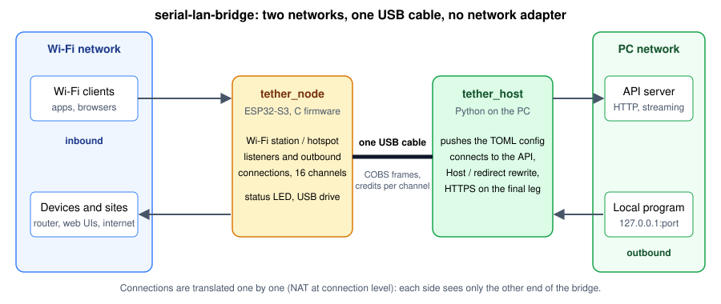

# serial-lan-bridge

Connects a **Wi-Fi network** and a **Windows PC's network** through an **ESP32-S3** on a single USB cable, in both directions.

* **Inbound:** clients on the Wi-Fi network reach an HTTP API on the PC's side (for example an OpenAI-compatible server,
  streaming included).
* **Outbound:** a local port on the PC is carried to an endpoint on the Wi-Fi network, or to any site through a universal
  forwarder that can speak HTTPS on the final leg.
* **No drivers and no network adapter on the PC.** The ESP32-S3 shows up as a plain COM port (plus a 1 MB USB drive); connections
  are translated one by one, so each side only sees the other end of the bridge.
* **One TOML file** configures Wi-Fi, an optional fallback hotspot and the port mappings, and is applied on every start.

**Recommended device:** an ESP32-S3 board with two USB-C ports (a dual-port ESP32-S3 such as the ESP32-S3-WROOM-1 N16R8,
16 MB flash and 8 MB PSRAM). The bridge needs a chip with a native USB device port (the ESP32-S3 has one; classic ESP32
boards behind a UART chip do not work). On a dual-port board, connect the PC to the native `USB` port; the second port (`COM` or `UART`) carries
the console log and flashes without button presses.

| Component | Directory | Role |
|---|---|---|
| **tether_node** | `tether_node/` | ESP32-S3 firmware (ESP-IDF, C): joins Wi-Fi, listens on ports, opens outbound connections, carries them over USB |
| **tether_host** | `tether_host/` | Python on the PC: pushes the configuration, connects to the API, listens on local ports, multiplexes everything over the serial port |

Design, wire protocol, configuration, build and operation: **[ARCHITECTURE.md](ARCHITECTURE.md)**. Configuration template with all
options: [tether.example.toml](tether.example.toml).
